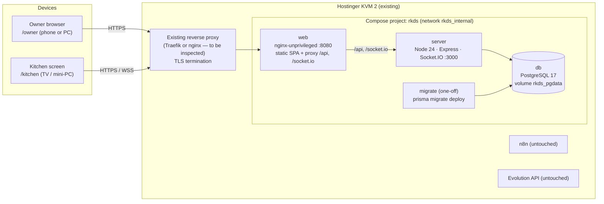
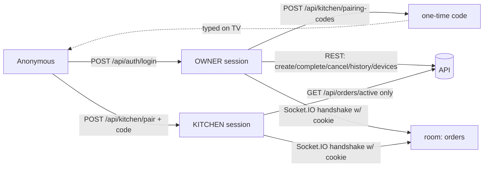
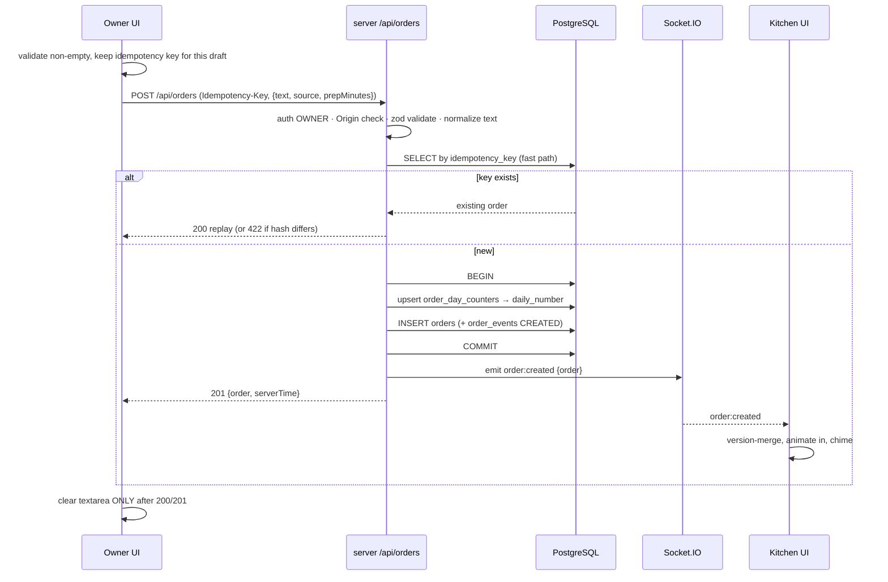
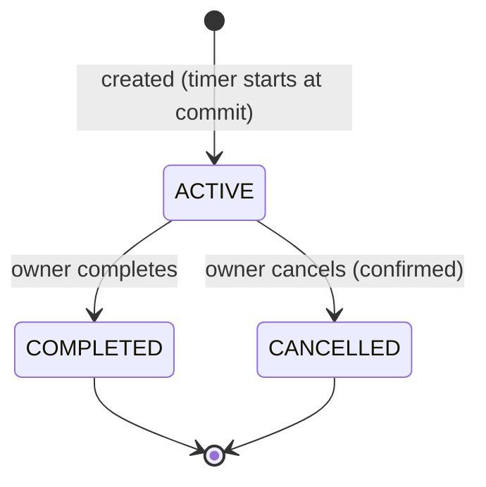

# Architecture — 91 Degree RKDS

Related: [DECISIONS.md](DECISIONS.md) · [REALTIME_FLOW.md](REALTIME_FLOW.md) · [DATABASE.md](DATABASE.md) · [SECURITY.md](SECURITY.md) · [DEPLOYMENT.md](DEPLOYMENT.md)

## 1. System overview



Only `web` is reachable from the proxy. `server` and `db` have no host ports. PostgreSQL is never published.

## 2. Components and responsibilities

| Component | Responsibilities | Must NOT |
|---|---|---|
| `apps/web` (React SPA) | Owner panel, kitchen display, pairing/login pages; API client with timeouts and idempotency; socket client; snapshot+event merge; clock-offset timers; error presentation | Generate authoritative numbers/timestamps; hold secrets; render order text as HTML |
| `apps/web/nginx` | Serve static assets; SPA history fallback; proxy `/api` + `/socket.io` (WebSocket upgrade) to `server`; security headers for HTML | Terminate public TLS (the host proxy does that) |
| `apps/server` | Config validation; auth/sessions; authorization; validation; order creation (numbering + idempotency); status transitions; audit; Socket.IO broadcast after commit; health; structured logs; CLI tools | Accept mutations over sockets; log order text or secrets |
| `packages/shared` | Zod schemas (API + socket payloads), error codes + HTTP map + user messages, constants, pure time functions (business date, timer state, formatting), text normalization | Import framework or DB code |
| `database/` | Prisma schema and versioned SQL migrations | Contain seed data for production |
| PostgreSQL | Source of truth for orders, counters, sessions, users, audit | Be reachable from outside `rkds_internal` |

## 3. Server module map (ownership)

```mermaid
flowchart TB
  main[main.ts bootstrap] --> app[app.ts Express factory]
  main --> rt[realtime/socket-server]
  app --> mw[http/middleware<br/>request-id · logger · security · rate-limit · error-handler]
  app --> health[modules/health]
  app --> auth[modules/auth]
  app --> kd[modules/kitchen-devices]
  app --> orders[modules/orders]
  orders --> repo[orders.repository<br/>raw SQL counter + conditional update]
  orders --> bc[realtime/broadcaster]
  kd --> bc
  auth --> sess[session.service]
  rt --> sess
  repo --> prisma[(db/prisma)]
  sess --> prisma
  orders --> shared[[@rkds/shared]]
  auth --> shared
```

| Module | Owns | Doc |
|---|---|---|
| `modules/orders` | Create, list, history, complete, cancel, numbering, idempotency, transitions, audit events | [DATABASE.md](DATABASE.md), [API_CONTRACTS.md](API_CONTRACTS.md) |
| `modules/auth` | Login/logout/session, password hashing, role guards, cookie handling | [SECURITY.md](SECURITY.md) |
| `modules/kitchen-devices` | Pairing codes, kitchen sessions, revocation | [SECURITY.md](SECURITY.md) |
| `realtime/*` | Socket auth, rooms, broadcasting, session sweeper | [REALTIME_FLOW.md](REALTIME_FLOW.md) |
| `http/middleware/*` | Cross-cutting HTTP concerns | [ERROR_HANDLING.md](ERROR_HANDLING.md), [SECURITY.md](SECURITY.md) |
| `cli/*` | Owner account management | [DEPLOYMENT.md](DEPLOYMENT.md) |

## 4. Authentication boundaries



- Cookie: `__Host-rkds_sid` (prod) / `rkds_sid` (dev). It is httpOnly, Secure (prod), SameSite=Strict, Path=/.
- Every request resolves the session from the token hash, checks expiry and revocation, and attaches `req.auth = { sessionId, role, userId? }`.
- Role guards: `requireRole('OWNER')`, `requireRole('OWNER','KITCHEN')`.

## 5. Order creation data flow



If the INSERT hits the `idempotency_key` unique constraint (a concurrent duplicate), the transaction rolls back, including the counter increment. The API then re-reads the existing order and responds as a replay.

## 6. Order lifecycle



A transition is one SQL statement, `UPDATE … WHERE id=$1 AND status='ACTIVE' RETURNING *`, plus an audit insert, in one transaction. It is broadcast as `order:updated` after commit. Clients remove the card only when they receive the confirmed status (from the HTTP response or the event).

## 7. Timer model

- Stored: `created_at`, `deadline_at = created_at + prep_minutes` (CHECK-enforced).
- Client: `remainingMs = deadlineAt − (Date.now() + clockOffset)`. The pure function `computeTimerState` lives in `@rkds/shared/time/timer.ts`.
- Phases (by remaining ms): `normal` > 300 000 · `warning` 0 < r ≤ 300 000 · `overdue` r ≤ 0 (the deadline instant itself is overdue, shown as `+00:00`).
- Rounding: remaining time is shown rounded **up** (ceil) and overdue time rounded **down** (floor), so `00:00` never appears as a countdown value.
- Display: `MM:SS` / `+MM:SS` / `+H:MM:SS`. All display uses Asia/Karachi.

## 8. Error handling and observability

There is one central error middleware, stable error codes from `@rkds/shared`, request IDs on every request and response, and pino JSON logs with redaction. Details: [ERROR_HANDLING.md](ERROR_HANDLING.md).

## 9. Deployment topology

- Compose project `rkds`, services `db`, `migrate`, `server`, `web`, network `rkds_internal` (bridge), volume `rkds_pgdata`.
- Start order: `db` (healthy) → `migrate` (completed successfully) → `server` (healthy) → `web`.
- Exposure: one overlay, chosen after inspecting the VPS (ADR-019, ADR-026).
- Details: [DEPLOYMENT.md](DEPLOYMENT.md).

## 10. Key invariants (do not break)

1. Success is reported to the owner only after COMMIT.
2. Socket events are emitted only after COMMIT, and never carry data that was not committed.
3. Order numbers come only from the DB counter inside the create transaction.
4. Status transitions are guarded by `WHERE status='ACTIVE'` in SQL, not only in application code.
5. Order text is never rendered as HTML and never logged.
6. PostgreSQL has no published host port.
7. Production has no seed data and no default credentials.
