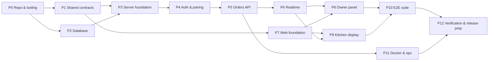

# Implementation Plan — 91 Degree RKDS

Phase 2 starts only after the owner explicitly approves the Phase 1 documents. Each step ends with its gates run and a dated report in `docs/reports/`. A step is complete only when its acceptance criteria are verified, not when the code is written.

Gate IDs (G1–G10) are defined in [TESTING.md](TESTING.md) §3.

## Dependency graph

## Steps

### P0 — Repository and tooling
- **Deliverables:** `git init` (with approval), npm workspaces, `tsconfig.base.json` (strict, `noUncheckedIndexedAccess`), ESLint flat config incl. bans (`dangerouslySetInnerHTML` and `$queryRawUnsafe` via `no-restricted-syntax`, test helpers imported from server `src`), Prettier, `.editorconfig`, `.gitignore`, `.nvmrc`, `.env.example`, root scripts (`dev`, `build`, `typecheck`, `lint`, `format:check`, `test:*`, `verify`, `verify:release`, `db:*`, `owner:create`, `check:security`), `docker-compose.dev.yml` + `database/init/01-create-test-db.sql`, Vitest root config with projects + coverage thresholds. Optional: `setup-pre-commit` skill (lint-staged + typecheck on pre-push) and `git-guardrails-claude-code`.
- **Acceptance:** `npm ci` succeeds; `npm run typecheck`/`lint` pass on an empty skeleton; `npm run db:up` starts Postgres with `rkds_dev` and `rkds_test`, owned by the non-superuser `rkds_app`.
- **Gates:** G1, G2, and `docker compose -f docker-compose.dev.yml config -q` (the production part of G8 starts in P11).

### P1 — Shared contracts (`packages/shared`)
- **Deliverables:** constants, Zod schemas (order, auth, kitchen, socket), error codes + messages, `business-date`, `timer`, `format`, `normalize-order-text`. Written test-first (`tdd` skill).
- **Acceptance:** all UNIT_TESTING.md §shared cases implemented and passing; time module ≥ 90% statements and branches.
- **Gates:** G1, G2, G3, G6 (shared).

### P2 — Database
- **Deliverables:** `database/schema.prisma`, the first migration with hand-written CHECKs (no partial indexes), `prisma.config.ts`, `db:migrate`, `db:migrate:check` scripts, `test-db.ts` guard.
- **Acceptance:** migration applies to an empty `rkds_test`; `migrations.int` and `schema-constraints.int` pass; zero rows after migrate.
- **Gates:** G4 (those suites), G9.

### P3 — Server foundation
- **Deliverables:** `env.ts`, `clock`, `logger` (redaction), `app.ts` with middleware order, `AppError`, `error-handler`, `request-timeout`, `db/errors`, `origin-check`, helmet, rate-limit config object (with multiplier) + global limiter, `health` routes, `main.ts` with graceful shutdown.
- **Acceptance:** `errors.int`, `security.int`, `health.int`, the **global-limiter** part of `rate-limit.int`, and unit tests for env/error-handler/request-timeout/db errors/logger pass. Route-specific limiter cases land with their routes in P4/P5.
- **Gates:** G1–G4.

### P4 — Auth, sessions and kitchen pairing
- **Deliverables:** `password.ts`, `session.service.ts`, `cookies.ts`, `require-role.ts`, auth routes, pairing service + routes, CLI (`create-owner`, `reset-owner-password`, `list-owners`, `disable-owner`), session cleanup job. Apply the `auth-implementation-patterns` skill.
- **Acceptance:** `auth.int`, `pairing.int`, `cli.int`, `session-cleanup.int`, and the login/pairing cases of `rate-limit.int` pass; cookie flags verified; disabled owners lose access; no default user exists after migrate.
- **Gates:** G1–G4, G10 (audit).

### P5 — Orders API
- **Deliverables:** repository (counter upsert, conditional update, keyset history, retention delete), `idempotency.ts`, `transitions.ts`, service, routes, DTO mapping, audit events, `order-retention` job (ADR-024).
- **Acceptance:** all `orders.*.int`, `idempotency.int`, `numbering.concurrency.int`, `order-retention.int`, `authorization.int`, `logging.int`, and the orders case of `rate-limit.int` pass; orders module ≥ 90% coverage.
- **Gates:** G1–G4, G6.

### P6 — Realtime
- **Deliverables:** `socket-server`, `socket-auth`, `broadcaster` (emit after commit), `session-sweeper`, logout/revoke disconnects.
- **Acceptance:** `socket.auth.int`, `socket.events.int` pass, including "no emit on rollback/replay".
- **Gates:** G1–G4.

### P7 — Web foundation
- **Deliverables:** Vite + React 19 + Router + Tailwind v4 tokens (DESIGN_SYSTEM), self-hosted fonts, `api-client`, `clock-sync`, `use-now`, `order-store`, `use-order-sync`, session context and route guards, `ErrorBoundary`, logo cropped from the menu images + favicon/app icons + `manifest.webmanifest` (NFR-12), UI primitives (Button, SegmentedControl, Textarea, Dialog, Toast, ConnectionPill, BrandMark, EmptyState, ErrorBanner), login and pairing pages. Apply the `ui-styling` and `ui-ux-pro-max` skills.
- **Acceptance:** web unit tests for api-client, clock-sync, use-now, order-store (≥ 90%) pass; `npm run build` produces a bundle with no secrets (`check:bundle-secrets`).
- **Gates:** G1–G3, G7.

### P8 — Owner panel
- **Deliverables:** `OrderComposer` (Paste-then-review + Send, Undo on replace, clipboard fallback, shortcuts, counter), `use-submit-order` (state machine, retry with the same key, draft persistence), `ActiveOrdersList` (two-step complete, cancel dialog), `HistoryPanel` (date/status/number limited to the 7-day window, pagination), `SettingsSheet` + `KitchenDevicesPanel`, header clock/count/pill/logout, responsive layouts.
- **Acceptance:** UNIT_TESTING.md owner cases pass; manual check on a phone width and a desktop width against DESIGN_SYSTEM.
- **Gates:** G1–G3, G7.

### P9 — Kitchen display
- **Deliverables:** `KitchenPage`, header (count, clock, pill, sound, full-screen), `OrderBoard` (grid, AnimatePresence, overflow indicator, empty state), `KitchenOrderCard` (number, timer phases, full text, source, Yesterday badge, NEW glow), `SoundControl` + Web Audio chime, wake lock, cursor auto-hide, density setting. Apply `emil-design-eng` / `improve-animations` for the motion audit.
- **Acceptance:** kitchen unit tests pass; 1920×1080 screenshot shows ≥ 8 short cards without scrolling; reduced motion verified.
- **Gates:** G1–G3, G7.

### P10 — E2E suite
- **Deliverables:** Playwright config, global setup, stack/auth/db fixtures (server restart control, backdated orders), all specs in E2E_TESTING.md including `latency.spec`, axe scans. Apply the `e2e-testing-patterns` skill.
- **Acceptance:** all specs pass on Chromium; `@smoke` passes on Firefox and WebKit; flakes recorded.
- **Gates:** G5.

### P11 — Docker, production config and operations scripts
- **Deliverables:** server and web Dockerfiles (multi-stage, non-root, pinned bases; `prisma` CLI in the server runtime), `nginx/default.conf` (SPA, Docker-DNS resolver + variable upstream, WebSocket, headers), `docker-compose.yml` + both overlays (explicit volume name, backups bind mount, init-prod mount), `database/init-prod/10-create-app-role.sh`, `.env.compose-check`, `scripts/lib/compose.sh`, `backup.sh`, `restore.sh`, `verify-backup.sh`, `vps-inspect.sh`.
- **Acceptance:** `npm run compose:check` passes for both overlays; app role is not a superuser; `docker stats` footprint recorded; prod-like local run healthy; E2E `@smoke` against the prod-like stack passes; CSP shows no violations; backup → verify → restore drill succeeds locally; `db` has no published port (`docker compose port db 5432` empty).
- **Gates:** G8, G5 (smoke), manual checklist.

### P12 — Verification and release preparation (Phase 3)
- **Deliverables:** `npm run verify:release` results, coverage report, `npm audit` results, `/security-review`, an independent review subagent pass (architecture/security/UX), fixes for critical/high findings, final docs sync, `docs/reports/latest.md` + final project report, exact deployment commands.
- **Acceptance:** all gates PASS, or explicitly BLOCKED/NOT RUN with reasons; no open critical/high issues; requirement traceability table re-checked.
- **Live VPS deployment** is a separate step that needs the owner's go-ahead plus the inspection output. It stays **NOT RUN** until then.

### P13 — Menu ordering, kitchen notes, louder alert (owner request 2026-10-30; ADR-027, ADR-028)
- **Deliverables:** menu data from the printed menu + verification checklist (MENU.md); migration `20261030120000_menu_orders_notes`; `GET /api/menu`; menu orders and notes in `POST /api/orders`; owner Menu / Paste / Type modes with + / −, summary and notes; kitchen card lines and KITCHEN NOTES; ~3.5 s alert with on/off, volume and test.
- **Acceptance:** all new and existing unit, integration and E2E tests pass; migration applies to an existing database without changing rows; Paste & Send unchanged; report in `docs/reports/`.

## Working agreements

- Implement in the order above. Shared contract changes after P1 follow CHANGE_WORKFLOW.md.
- Commit per step with a descriptive message (only once the repo exists and the owner agrees to commits).
- Subagents may be used for independent reviews (P12) and parallel test authoring, but never for concurrent edits to the same files.
