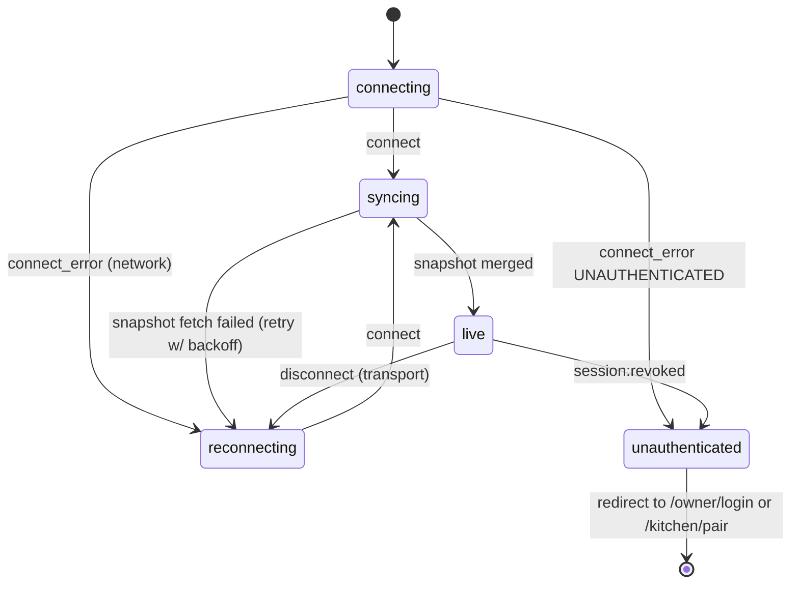

# Real-time Flow — 91 Degree RKDS

Socket.IO 4, same origin, path `/socket.io`. PostgreSQL is the source of truth. A socket event is a hint that state changed and never the only record of anything.

Related: [ARCHITECTURE.md](ARCHITECTURE.md) · [API_CONTRACTS.md](API_CONTRACTS.md) · [ERROR_HANDLING.md](ERROR_HANDLING.md) §5 (socket disconnect / reconnect rows)

## 1. Connection and authorization

1. The client calls `io({ path: '/socket.io', withCredentials: true })` with the **default transport order** (HTTP long-polling handshake, then upgrade to WebSocket). If WebSocket is blocked by a proxy, the connection simply stays on polling. Same origin, so the session cookie is sent.
2. Server `allowRequest`: reject if an `Origin` header is **present and** ≠ `APP_ORIGIN`. A missing Origin is allowed, because browsers omit it on same-origin GET polling requests. Cross-site browser requests always carry Origin, so they are still rejected, and the cookie session check below still applies to every connection.
3. Server `io.use` middleware: parse the cookie, then `sessionService.resolve(token)`. A missing, expired or revoked session triggers `next(new Error('UNAUTHENTICATED'))`, which the client receives as `connect_error` with `err.message === 'UNAUTHENTICATED'`.
4. On success:
   - `socket.data.auth = { sessionId, role }`
   - `socket.join('orders')` (OWNER and KITCHEN both receive order events)
   - `socket.join('session:' + sessionId)` (targeted revocation)
   - emit `server:hello { serverTime, role }`
5. No client→server handlers are registered (ADR-009). `socket.onAny` logs unexpected events at `debug` and ignores them.
6. **Session sweeper:** every 60 s the server re-validates the distinct session IDs of connected sockets in one query. Invalid sessions get `session:revoked` and are disconnected.

## 2. Events (server → client)

All payloads are validated by Zod schemas in `@rkds/shared/schemas/socket.ts`. The client validates them too and drops malformed payloads (logged in dev).

| Event | Payload | When |
|---|---|---|
| `server:hello` | `{ serverTime: string, role }` | After an authenticated connect |
| `order:created` | `{ order: OrderDto, serverTime }` | After the create transaction commits (not on idempotent replay) |
| `order:updated` | `{ order: OrderDto, serverTime }` | After a complete/cancel commit (not when `alreadyApplied`) |
| `session:revoked` | `{ reason: 'LOGOUT' \| 'REVOKED' \| 'EXPIRED' }` | Immediately before the server disconnects that session's sockets |

Emits run in `realtime/broadcaster.ts`, which the order service calls **after** `$transaction` resolves. A failed emit is logged and never fails the HTTP request.

## 3. Client state machine



UI mapping (ConnectionPill):
| State | Pill | Kitchen behaviour |
|---|---|---|
| connecting / syncing | "Connecting…" (grey, spinner) | Keep showing last known cards; timers keep running from deadlines |
| live | "Live" (green dot) | Normal |
| reconnecting | "Reconnecting…" (amber) after 2 s grace; "Offline" (red) after 30 s or `navigator.onLine === false` | Cards stay, banner "Connection lost — showing last known orders" |
| unauthenticated | — | Redirect |

After returning to `live` from `reconnecting`, show "Reconnected" briefly (2 s).

## 4. Snapshot + event merge (race-safe)

Store: `Map<orderId, OrderDto>` for active orders plus `tombstones: Map<orderId, version>` for orders seen in a terminal state, held in a reducer (`apps/web/src/realtime/order-store.ts`), plus `syncing` and `buffer`. Tombstones stop a late `order:created` (v1), for example an HTTP response arriving after the socket's `order:updated` (v2), from bringing back a ghost card. Tombstones older than 24 h are pruned.

```
on 'connect':
  syncing = true; buffer = []
  snapshot = GET /api/orders/active          // includes serverTime → clock sample
  replaceActive(snapshot.orders)             // authoritative: drop ACTIVE cards absent from snapshot
  for e in buffer: apply(e)                  // events that raced the fetch
  syncing = false

on 'order:created' | 'order:updated' (e):
  if syncing: buffer.push(e) else apply(e)

apply(e):
  known = max(map.get(id)?.version, tombstones.get(id)) // undefined if never seen
  if known && known >= e.order.version: ignore          // duplicate or stale
  if e.order.status === 'ACTIVE': map.set(id, e.order)  // new or updated
  else: map.delete(id); tombstones.set(id, e.order.version)  // card animates out
```
`replaceActive(snapshot)` also skips snapshot orders whose tombstone version is ≥ their version.

Guarantees:
- **Duplicates** (the same event twice, or both an event and an HTTP response) are ignored by the version check. Tombstones extend this to orders that already left the board.
- **Out of order** events: a lower version never overwrites a higher one.
- **Missed events** during a disconnect are healed by the snapshot on reconnect.
- **Belt-and-braces resync:** the client also re-fetches the snapshot on `visibilitychange → visible` and every 5 minutes while live.

Owner-originated changes: the owner UI applies the HTTP response (with version) through the same `apply()`, so the socket echo is a no-op.

## 5. Clock synchronization

- Samples: every response carrying `serverTime` (`/auth/session`, `/orders/active`, mutations) and `server:hello`.
- `offset = serverTime − (t0 + rtt/2)`, with `t0`/`t1` measured around the fetch. For socket hello, `rtt` is assumed 0.
- Keep the last 5 samples and use the median. `now()` = `Date.now() + offset`.
- If `|offset| > 120 s`, show a subtle "Device clock is off by N min — timers corrected" note.
- Unit-tested in `clock-sync.test.ts`.

## 6. New-order sound and highlight

- Triggered only by live `order:created` events applied while `live` (not by snapshot loads), so reconnecting does not replay alerts.
- ADR-028: `OrderAlert` (`apps/web/src/lib/sound.ts`) plays one ~3.5 s Web Audio bell sequence per **order id**; a repeated event for the same id is ignored (the last 300 ids are remembered). Orders arriving during an alert produce exactly one follow-up alert.
- No audio file. On/off and volume (10–100 %, default 80 %) are kept in `localStorage` per screen. The kitchen header bell opens the settings (on/off, volume, Test sound) and shows whether sound is actually audible; a "Tap to enable sound" banner appears while the browser blocks audio.
- Audio failures return a result code and never throw, so they cannot affect the order list or the socket.
- Menu orders and kitchen notes travel in the same `OrderDto` payload (`kind`, `items`, `notes`; ADR-027). There are no new events.
- The "NEW" highlight lasts 8 s from the client receive time.

## 7. Proxy requirements

The web nginx and host proxy must forward `Upgrade`/`Connection` headers for `/socket.io/`, set `proxy_read_timeout ≥ 75s`, and must not buffer. If WebSocket upgrade is blocked, the connection stays on long-polling (the default handshake transport). That works without sticky sessions because there is a single server instance. See [DEPLOYMENT.md](DEPLOYMENT.md).

## 8. Tests

| Behaviour | Test |
|---|---|
| Unauthenticated / revoked handshake rejected; foreign Origin rejected; missing Origin accepted with a valid cookie; polling-only client connects | `socket.auth.int.test.ts` |
| Tombstone blocks a late create after a terminal update | `order-store.test.ts` |
| Event emitted only after commit, payload valid | `socket.events.int.test.ts` |
| Logout and revoke disconnect sockets | `socket.auth.int.test.ts` |
| Merge: duplicate, stale, buffered-during-sync | `order-store.test.ts` (unit, web) |
| Reconnect heals missed events | `resilience.spec.ts` (E2E) |
| Server restart, timers intact | `resilience.spec.ts` (E2E) |
